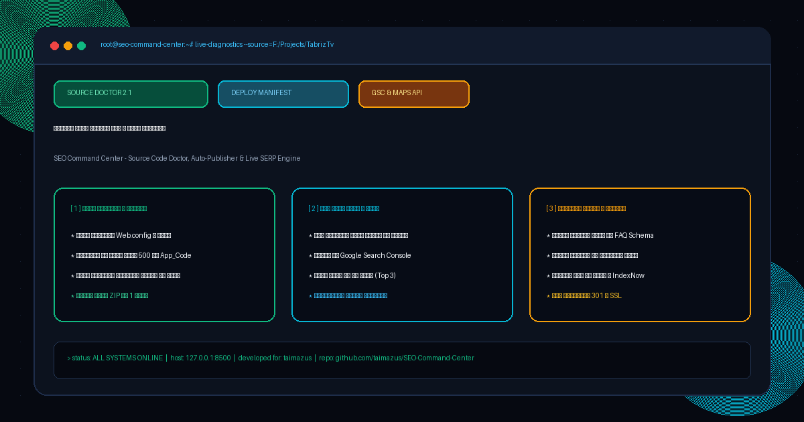

<div align="center">

# 🚀 مرکز فرماندهی و اتوماسیون سئو چندسایته
### SEO Command Center — Multi-Tenant SEO Platform, Source Doctor, Auto-Publisher & Live SERP Engine

[](https://python.org)
[](https://fastapi.tiangolo.com)
[](https://www.w3.org/WAI/standards-guidelines/wcag/)
[](https://opensource.org/licenses/MIT)
[](https://github.com/taimazus/SEO-Command-Center)

<br/>



<br/><br/>

</div>

<div dir="rtl">

## 📖 معرفی پلتفرم

**SEO Command Center** یک مرکز فرماندهی و پلتفرم مهندسی سئو متمرکز برای آژانس‌های دیجیتال مارکتینگ و توسعه‌دهندگان وب است. این سیستم به شما امکان می‌دهد **ده‌ها وب‌سایت مشتریان و پروژه‌های شخصی** را با طراحی مدرن و با کنتراست بالای **WCAG AA** مدیریت کنید.

ویژگی متمایز این پلتفرم، ماژول اختصاصی **«پزشک سورس‌کد (Source Doctor)»** است که سورس‌کد محلی وب‌سایت شما را (ASP.NET, PHP, HTML) اسکن کرده، ایرادات فنی و ریدایرکت‌های ۳۰۱ را به صورت خودکار اصلاح می‌کند و دقیقاً مسیرهای آپلود فایل‌ها روی هاست را به همراه **بسته فشرده ZIP آماده انتشار** به شما تحویل می‌دهد.

---

## ✨ امکانات جامع سیستم

### ۱. پزشک سورس‌کد و دستیار انتشار (Source Doctor & Publisher)
* **اسکن عمیق کدهای پروژه:** وارد کردن آدرس پوشه پروژه (مانند `F:\Projects\TabrizTv`) و بازرسی کدهای Web.config، مسترپیج‌ها و صفحات فرود.
* **پیشگیری از خطای سرور ۵۰۰ (CS0103):** شناسایی فوری فایل‌های code-behind که به اشتباه در پوشه `App_Code` قرار گرفته‌اند.
* **اصلاح خودکار (Auto-Fix):** درج خودکار قوانین ریدایرکت دائمی ۳۰۱ در Web.config با ایجاد نسخه پشتیبان `.bak`.
* **راهنمای دقیق آپلود (Deployment Manifest):** ارائه جدول شفاف از فایل‌های تغییریافته و پوشه مقصد دقیق آنها روی هاست پلسک (`httpdocs/`، `httpdocs/panel/` و...).
* **خروجی بسته ZIP آماده پابلیش:** ایجاد یک فایل ZIP از کلیه فایل‌های نیازمند استقرار با یک کلیک.

### ۲. اتصال به سرچ کنسول گوگل و نقشه (Google Search Console & Maps)
* خواندن مستقیم و روزانه کلیک‌ها، ایمپرشن‌ها، CTR و میانگین رتبه.
* بررسی و پایش وضعیت حضور کسب‌وکار در **پک نقشه گوگل (Local Map Pack Top 3)**.
* تفکیک کلمات کلیدی پربازدید و تحلیل روند رشد کلمات در نتایج جستجو.

### ۳. رصد لحظه‌ای و تحلیل موقعیت کلمات (SERP Rank Tracker)
* پایش موقعیت دامنه در نتایج ارگانیک گوگل روی کلمات کلیدی هدف (مثل *«تعمیرات تلویزیون در تبریز»*).
* نمودارهای توزیع رتبه‌ها (صفحه اول، صفحه دوم و نیاز به بهبود) با گرافیک مدرن Chart.js.
* محاسبه خودکار میزان صعود یا نزول رتبه‌ها در هر استعلام.

### ۴. کارخانه تولید محتوای هوشمند سئو (AI Content Autopilot)
* تولید خودکار مقالات تخصصی، بومی و غنی از کلمات کلیدی.
* تولید استاندارد کدهای اسکیما **FAQ Schema** (`application/ld+json`).
* ذخیره مستقیم در پایگاه داده جهت انتشار در سایت.

### ۵. ایندکس آنی و تست سلامت فنی (Instant Indexer & Health Audit)
* ارسال سریع لینک‌ها به پروتکل **IndexNow** و خزش مستقیم از روی `sitemap.xml`.
* آزمون خودکار کارکرد ریدایرکت ۳۰۱ نسخه www، گواهی SSL، تگ H1 و تگ Canonical.

---

## 🎨 استانداردهای طراحی و کنتراست (UI/UX)
* **پایبندی کامل به استاندارد WCAG AA:** نسبت کنتراست متن به پس‌زمینه بیش از ۶.۵:۱ با خوانایی فوق‌العاده در محیط‌های تاریک.
* **رنگ‌بندی مدرن ابسیدین و نئون زمردی (Obsidian & Electric Emerald):** پس‌زمینه عمیق Onyx با بج‌های تفکیک‌شده و خطوط شبکه ماتریس.
* **تایپوگرافی استاندارد فارسی:** استفاده از فونت مدرن **وزیرمتن (Vazirmatn)**.

---

## 🚀 راهنمای راه‌اندازی سریع

### روش ۱: اجرای تک‌کلیکی (در ویندوز)
کافیست روی فایل **`اجرای پنل سئو.bat`** در دسکتاپ دابل‌کلیک کنید! داشبورد به طور خودکار در مرورگر باز خواهد شد.

### روش ۲: اجرا از طریق خط فرمان
```bash
cd C:\Users\Taimazus\Desktop\SEO-Command-Center
pip install -r requirements.txt
python run.py
```
سپس در مرورگر خود آدرس **`http://127.0.0.1:8500`** را باز کنید.

---

## 🧪 اجرای آزمون‌های خودکار
برای اطمینان از صحت کارکرد تمام ۱۳ تست سیستم:
```bash
python -m pytest tests -v
```

---

## 📄 مجوز انتشار (License)
این پروژه تحت مجوز متن‌باز **MIT** برای استفاده، توسعه و سفارشی‌سازی تجاری منتشر شده است.

</div>
